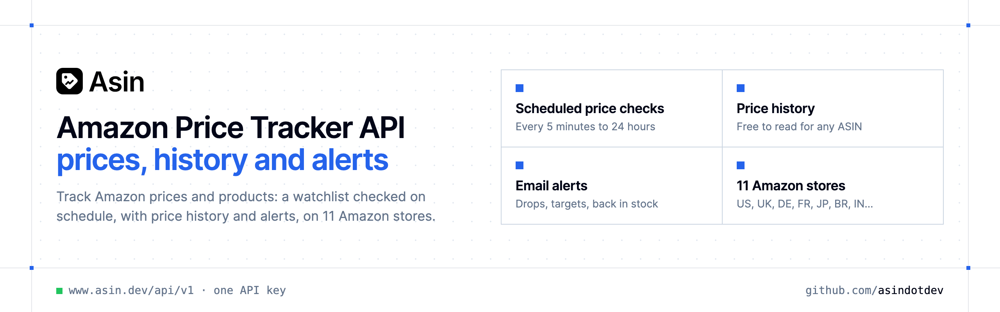

<p align="center">
  <a href="https://www.asin.dev"></a>
</p>

<p align="center">

[](https://www.asin.dev) [](https://www.asin.dev/signup) [](https://www.asin.dev/docs)

</p>

**Asin** tracks **Amazon prices and products**: add an ASIN or an Amazon link to your watchlist, Asin checks it on schedule, keeps every check as price history and emails you when the price drops, reaches your target or the product is back in stock. Everything in the app is available through a REST API, an MCP server and a Chrome extension.

### Why Asin?

- **A watchlist that runs on its own** — each product is checked on schedule, from every 5 minutes to every 24 hours depending on the plan.
- **Price history for any ASIN** — read every price Asin has seen, free and without tracking the product.
- **Alerts by email** — price drops, target prices and products back in stock.
- **Pay for what you check** — each price check costs 1 credit (about 30 credits a month for a product checked daily) and failed checks are refunded. Free for 50 products.
- **Use it your way** — the same API key works with the REST API, the MCP server and the Chrome extension, with official SDKs in 7 languages.
- **Copy-paste examples** — Python and TypeScript in each README, 7 more languages in `examples/`.

```bash
curl -G https://www.asin.dev/api/v1/history \
  -H "Authorization: Bearer $ASIN_API_KEY" \
  --data-urlencode "asin=B09DFCB66S"
```

### Official SDKs

Use Asin from your own language with a typed client:

| SDK | Package | Install |
| --- | --- | --- |
| Node.js | [`@asindev/sdk`](https://www.npmjs.com/package/@asindev/sdk) | `npm install @asindev/sdk` |
| Python | [`asindotdev`](https://pypi.org/project/asindotdev/) | `pip install asindotdev` |
| Go | [`asin-go`](https://pkg.go.dev/github.com/asindotdev/asin-go) | `go get github.com/asindotdev/asin-go` |
| .NET | [`Asin`](https://www.nuget.org/packages/Asin) | `dotnet add package Asin` |
| Ruby | [`asindotdev`](https://rubygems.org/gems/asindotdev) | `gem install asindotdev` |
| PHP | [`asindotdev/sdk`](https://packagist.org/packages/asindotdev/sdk) | `composer require asindotdev/sdk` |
| Java | [`asin-java`](https://github.com/asindotdev/asin-java) | build from source, see its README |
| CLI | [`@asindev/cli`](https://www.npmjs.com/package/@asindev/cli) | `npm install -g @asindev/cli` |
| MCP server | [`@asindev/mcp`](https://www.npmjs.com/package/@asindev/mcp) | `npx -y @asindev/mcp` |

### Repositories

- [**Amazon Offers API**](https://github.com/asindotdev/amazon-offers-api) — Who sells an Amazon product and at what price
- [**Amazon Price Alerts API**](https://github.com/asindotdev/amazon-price-alerts-api) — Get an email when an Amazon price drops or reaches your target
- [**Amazon Price History API**](https://github.com/asindotdev/amazon-price-history-api) — Every price Asin read for an ASIN, with lowest, highest and average
- [**Amazon Price Tracker API**](https://github.com/asindotdev/amazon-price-tracker-api) — A watchlist of Amazon products, checked on schedule
- [**Amazon Search API**](https://github.com/asindotdev/amazon-search-api) — Find the ASIN of any Amazon product by keyword

### Official SDKs and tools

[Python](https://github.com/asindotdev/asin-python) · [Node.js & TypeScript](https://github.com/asindotdev/asin-node) · [Go](https://github.com/asindotdev/asin-go) · [PHP](https://github.com/asindotdev/asin-php) · [Ruby](https://github.com/asindotdev/asin-ruby) · [Java](https://github.com/asindotdev/asin-java) · [.NET](https://github.com/asindotdev/asin-dotnet) · [CLI](https://github.com/asindotdev/asin-cli) · [MCP server](https://github.com/asindotdev/asin-mcp)

---

📚 [API reference](https://www.asin.dev/docs) · 🔑 [Get your API key](https://www.asin.dev/signup) · 🌐 [www.asin.dev](https://www.asin.dev)
